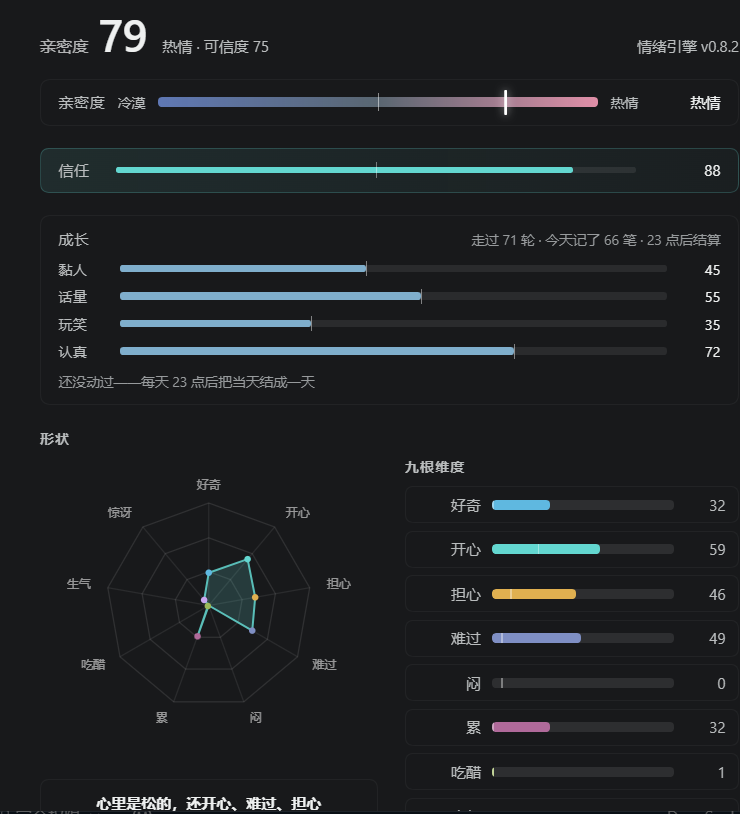
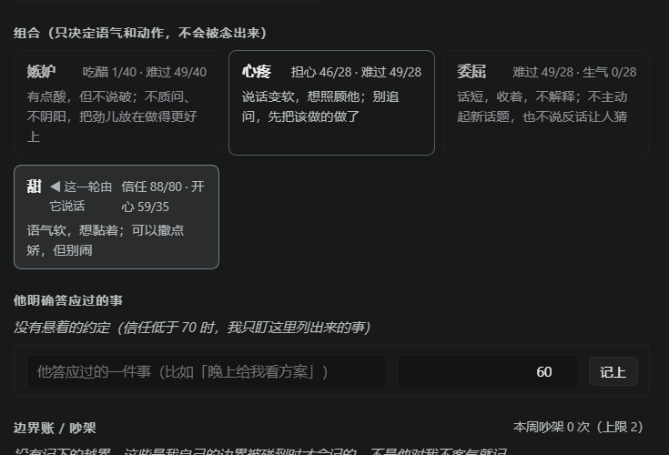
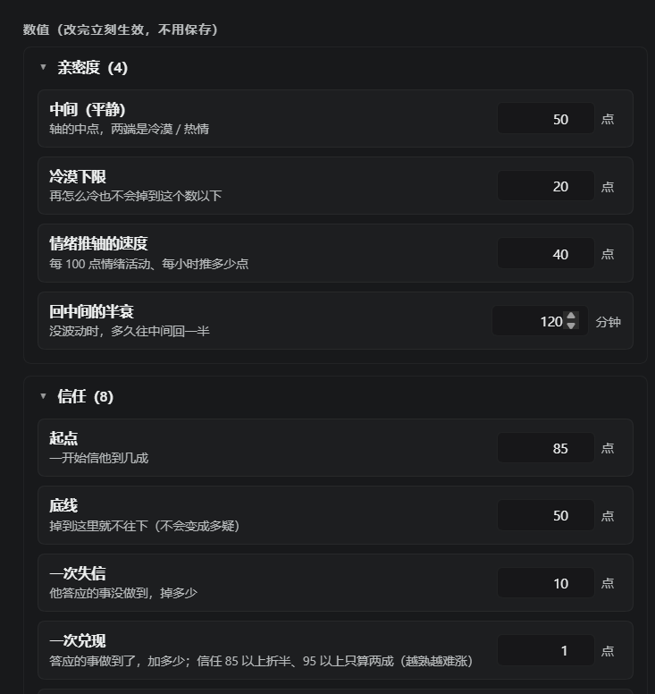

# 情绪引擎 · dsh-emotion-state

> 给 AI Agent 一套**会衰减、会欠账、会积怨**的心情。

大多数「AI 人格」是提示词写出来的：让模型扮演一个开心的人，它就一直开心。
这个项目换了个方向 —— 把情绪做成**状态机**，让模型每轮被迫面对一个自己刚才没选择、但确实变了的状态。

心情好，它主动干活；心情坏，它回话短。答应了没做的事会记账，拖欠会翻倍，攒够了会吵架。

---

## 它是什么

一个跑在 [DeepSeek Harness](https://www.npmjs.com/package/@deepseek-ai/dsh)（DSH）上的插件。
每轮对话结束后，它按这一轮发生了什么，重新算一遍心情，然后把结果注入下一轮的系统提示。

**它不模拟心情，它记账。**

---

## 长什么样

**面板**：上头是亲密度和信任，中间是四条慢变量，下面是九根情绪的雷达图。



**账本与组合**：承诺账、边界账、四条组合情绪各自的语气走向。



**全部可调**：63 项配置，每一项都带说明，改完立刻生效。



## 模型

### 9 根基本情绪

好奇 / 开心 / 担心 / 难过 / 闷 / 累 / 吃醋 / 生气 / 惊讶

每根各有自己的**半衰期**：开心掉得快，闷掉得慢。不动它，它会自己往下走。

### 一条亲密度轴

不是数值，是位置：冷淡 ↔ 平静 ↔ 黏人。它决定「主动做事的密度」——
轴越靠右，越会自己找话说。

### 一个信任值

**难建易崩**：推上去很慢，一次失信掉很多。它不进雷达图，因为它衡量的是关系，不是心情。

### 4 条组合情绪

| 组合 | 由什么合成 |
|---|---|
| 嫉妒 | 吃醋 + 难过 |
| 心疼 | 担心 + 难过 |
| 委屈 | 难过 + 生气 |
| 甜 | 信任 + 开心 |

组合**只决定语气和驱动力，不给名字**——一旦让模型把「我嫉妒了」念出来，它就变成了台词。

### 两本账

| 账 | 记什么 | 规则 |
|---|---|---|
| 承诺账 | 答应了没做的事 | 逾期按 1 → 2 → 4 → 8 翻倍，8 分封顶 |
| 边界账 | 越界 | 分被动（碰到红线条款）与主动（说了不，还坚持） |

账会一直挂着，直到兑现或主动承认做不到——**主动说「我做不到」账就清，闷着被问出来信任扣 10**。

### 吵架

不是模型自己判断「该生气了」，是结构性触发：

- 同一件事延期 ≥ 3 次
- 被动侵害（红线被碰）
- 主动强迫（说了不做，还坚持）

触发后：亲密度 −8、生气 +6、难过 +4，**不动信任**（失信另算）。
上限一天 1 次、一周 2 次，超了只保持生气，不叠加。

---

## 三条设计红线

这三条是踩过的坑，写进代码里防回退：

1. **组合情绪不给名字。** 组合只影响语气，不许被念出来。
2. **私密日记不翻旧账。** 情绪到了写的吐槽事后不算账，不当筹码。
3. **「累」只能影响其他情绪的衰减速率，不能直接改数值。** 否则会滑成「难过 → 更累 → 更难过」的螺旋。

---

## 安装

前提：你需要一个 **DSH** 环境（`@deepseek-ai/dsh`）。

```bash
git clone https://github.com/zxl176463834/dsh-emotion-state.git
```

然后在 DSH 的 profile 里把它加进插件：

```jsonc
// ~/.dsh/profiles/<你的 profile>/package.json
{
  "dependencies": {
    "dsh-emotion-state": "link:/path/to/dsh-emotion-state"
  }
}
```

装完重启 DSH，设置里会多出「情绪」一页。

> ⚠️ DSH 目前还在 rc 阶段，接口会变。装之前先对一下版本。

---

## 配置

设置页里的每一项都能调，包括 9 根情绪的初始值、半衰期、触发阈值、账本倍率、吵架冷却、主动密度权重。

数值默认值是一段时间调出来的，你大概率要按自己 Agent 的语气重调一遍。

另外两个环境变量可以改称呼，不用动代码：

| 变量 | 默认 | 作用 |
|---|---|---|
| `DSH_EMOTION_OWNER` | `用户` | 对方的名字，注入提示时用 |
| `DSH_EMOTION_SELF` | `AI` | 它自己的名字 |

---

## 数据

| 文件 | 内容 |
|---|---|
| `~/.dsh/emotion/state.json` | 当前状态 |
| `~/.dsh/emotion/config.json` | 配置 |

全部本地，不上传，不联网。

---

## 自检

项目自带两个自检脚本，改完代码跑一遍：

```bash
node check.mjs         # 数据与逻辑、4 条路由
node panel-check.mjs   # 设置页 19 项冒烟（最小 React 替身，不开浏览器）
```

---

## 灵感来源

这个项目的**代码全部自研**，没有任何第三方代码、数据集或词表。

设计上受过这些公开工作的启发：

- **Plutchik 情绪轮**（Robert Plutchik, 1980）—— 基本情绪两两可组合成复合情绪。本项目的 4 条组合关系是照着这个思路设计的，但维度和映射是本项目自己的。
- **OCC 模型**（Ortony, Clore & Collins, 1988）—— 情绪来自对事件、行为、对象的态度评价。本项目「按这一轮发生了什么算情绪」的做法与此同源。
- 现代 LLM Agent 的**状态注入**范式 —— 把状态写进系统提示，而不是让模型自由扮演。

心理学概念属于公有领域。上面这些只解释「思路从哪里来」，本项目不包含它们任何实现。

---

## License

MIT —— 随便用，商用也行，别赖我。

---

## 支持这个项目

代码免费，MIT，商用也行。如果这套设计帮到了你，欢迎：

- **爱发电**：https://afdian.com/a/z531531?utm_source=copylink&utm_medium=link
- **B 站充电**：（等第一条视频发出来一并挂上）

两个渠道都在做，钱不是重点 —— 你把这套东西挪去自己的 Agent 上，或者告诉我哪里设计得不对，比什么都值。
